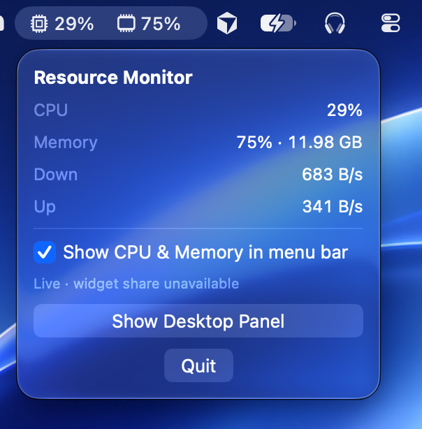
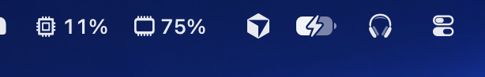
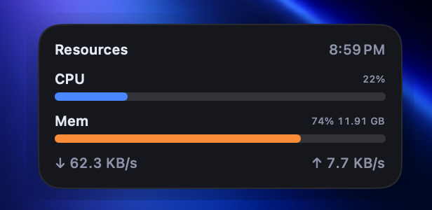

# Menu bar resource monitor for macOS

**Menu bar resource monitor for macOS** is built to display **CPU**, **memory**, and **network** usage in real time from the menu bar. It also features a floating **desktop panel widget** for a richer on-screen view.

<p align="center">
  
  
  
</p>

## Screenshots

### Menu popover

<p align="center">
  
</p>

### Menu bar

<p align="center">
  
</p>

### Desktop panel

<p align="center">
  
</p>

## Features

- **Menu bar monitor** — glanceable CPU and memory with SF Symbol icons
- **Optional menu bar values** — toggle “Show CPU & Memory in menu bar” for live percentages next to the icons
- **Desktop Panel** — dark, borderless floating card with CPU, memory, and network rates
- **WidgetKit extension** — system desktop widget (updates are throttled by macOS; the menu bar / panel stay live)
- Samples about every **3 seconds** so the UI stays calm

## Requirements

- macOS 14 or later (developed on newer releases as well)
- Xcode 15+ (Xcode 27 if you’re on macOS 27)
- Apple ID for signing

## Project layout

```
ResourceMonitor/
├── ResourceMonitor/                 # Menu bar app + desktop panel
│   ├── ResourceMonitorApp.swift     # App entry, menu bar, panel window
│   ├── ContentView.swift            # Main window / setup UI
│   ├── DesktopPanelView.swift       # Floating dark desktop panel
│   ├── MenuBarMetricsImage.swift    # Menu bar icon + percent rendering
│   ├── MetricsSamplerService.swift  # Live sampling timer
│   ├── ResourceMonitor.entitlements
│   └── Assets.xcassets/
├── ResourceMonitorWidget/           # WidgetKit extension
│   ├── ResourceMonitorWidget.swift
│   ├── ResourceMonitorWidgetBundle.swift
│   ├── Info.plist
│   └── ResourceMonitorWidget.entitlements
├── Shared/                          # Shared models + system APIs
│   ├── MetricsModels.swift
│   ├── MetricsStore.swift
│   └── SystemMetricsSampler.swift
├── screenshots/                     # README screenshots
├── ResourceMonitor.xcodeproj
├── README.md
└── .gitignore
```

| Piece | Role |
| --- | --- |
| `SystemMetricsSampler` | Reads CPU, memory, and network via Darwin APIs |
| `MetricsSamplerService` | Timer-driven sampling for the running app |
| `MetricsStore` | Optional App Group sharing for the widget |
| `DesktopPanelView` | Floating dark desktop panel UI |
| `MenuBarMetricsImage` | Fixed-width menu bar icon + percent rendering |
| `ResourceMonitorWidget` | System WidgetKit extension |

## Notes on the widget

WidgetKit does **not** refresh as often as an in-process menu bar app. Keep ResourceMonitor running for live values; treat the system widget as a best-effort glance.

If the menu bar status says **widget share unavailable**, App Group writes aren’t succeeding yet — the menu bar and desktop panel still work locally.

## Privacy

All metrics are read locally from the system. Nothing is sent over the network.
